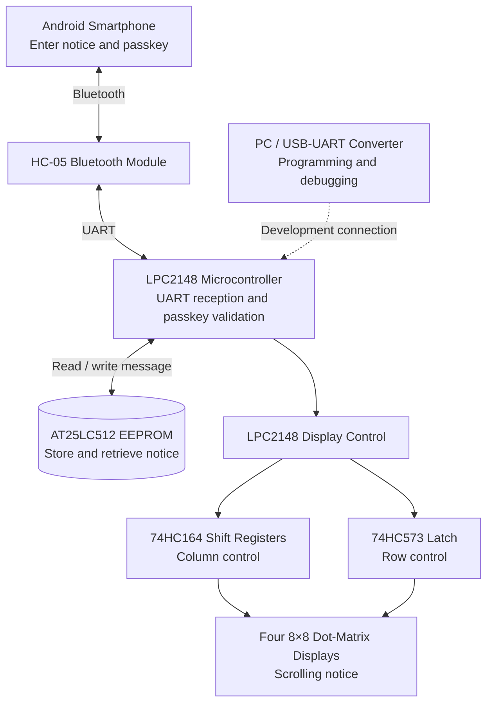
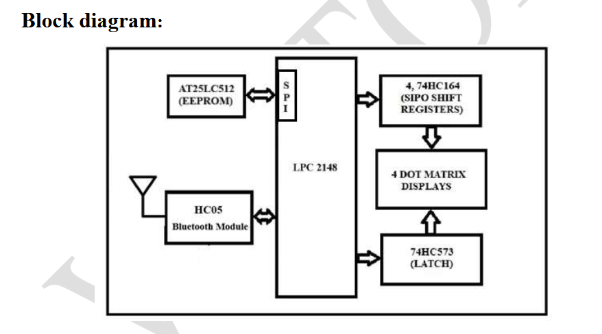
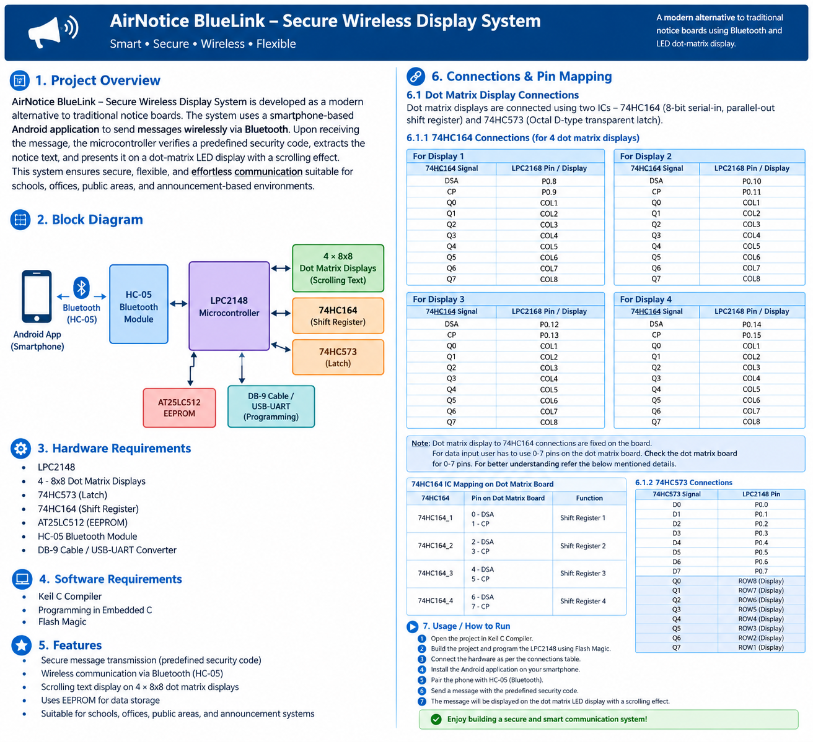

# AirNotice BlueLink -- Secure Wireless Display System

A Bluetooth-enabled electronic notice board that receives messages from
an Android smartphone, validates a predefined passkey, stores the
accepted notice in EEPROM, and displays it as scrolling text on four 8×8
LED dot-matrix displays.

## Table of Contents

-   [Overview](#overview)
-   [Block Diagram](#block-diagram)
-   [Features](#features)
-   [Hardware Requirements](#hardware-requirements)
-   [Software Requirements](#software-requirements)
-   [Working Principle](#working-principle)
-   [Message Format](#message-format)
-   [Hardware Connections](#hardware-connections)
-   [Implementation Sequence](#implementation-sequence)
-   [Build and Programming](#build-and-programming)
-   [Notes and Limitations](#notes-and-limitations)

## Overview

Traditional notice boards require messages to be written or replaced
manually. **AirNotice BlueLink** provides a wireless alternative using
an Android smartphone and an HC-05 Bluetooth module.

The LPC2148 microcontroller receives the message through UART, checks
the predefined passkey, extracts the notice text, and stores the
accepted message in AT25LC512 EEPROM. The saved message is then scrolled
across four 8×8 dot-matrix LED displays.

The system is intended for schools, offices, public areas, and other
announcement-based environments.

## Block Diagram

GitHub renders Mermaid diagrams directly in Markdown.



## Features

-   Wireless notice transmission from an Android smartphone using
    Bluetooth.
-   Passkey validation before accepting a message.
-   Message storage in EEPROM so the current notice can be retrieved and
    displayed.
-   Scrolling text across four 8×8 dot-matrix LED displays.
-   Displays **`Waiting for message`** when no message is available in
    EEPROM, as specified in the project procedure.
-   Uses UART for Bluetooth communication.

> **Security note:** The documented design uses a predefined passkey and
> message syntax. This should not be described as encrypted
> communication unless encryption has been implemented separately.

## Hardware Requirements

  ---------------------------------------------------------------------
  Component                          Purpose
  ---------------------------------- ----------------------------------
  LPC2148                            Main microcontroller

  4 × 8×8 dot-matrix displays        Scrolling notice output

  74HC164                            Serial-in, parallel-out shift
                                     registers for display columns

  74HC573                            Octal latch for display rows

  AT25LC512 EEPROM                   Persistent notice storage

  HC-05 Bluetooth module             Wireless communication with the
                                     Android phone

  DB-9 cable / USB-UART converter    Programming or serial-interface
                                     connection, as applicable to the
                                     setup
  ---------------------------------------------------------------------

## Software Requirements

-   Keil C Compiler
-   Embedded C
-   Flash Magic
-   Android Bluetooth terminal application for sending test messages

## Working Principle

1.  **Initialize peripherals:** Configure the LPC2148 peripherals
    required for UART, EEPROM access, and dot-matrix control.
2.  **Receive a message:** The Android phone sends data wirelessly to
    the HC-05 module. The module passes the received data to the LPC2148
    through UART.
3.  **Validate the passkey:** The microcontroller checks the received
    message against the predefined passkey/message syntax.
4.  **Extract the notice:** If the message is valid, the passkey markers
    are removed and the notice text is extracted.
5.  **Update EEPROM:** The accepted notice is written to the designated
    EEPROM locations.
6.  **Read the saved notice:** The program retrieves the latest stored
    notice from EEPROM.
7.  **Scroll the notice:** The microcontroller controls the 74HC164 and
    74HC573 devices to display the message on the four dot-matrix
    displays.
8.  **Handle new messages:** When a new valid message is received, the
    current scrolling notice is stopped or updated, and the new notice
    is stored and displayed.
9.  **Handle empty storage:** If no notice is stored, the display
    scrolls `Waiting for message`.

## Message Format

The project document gives this example:

**Bluetooth input:**

``` text
$$786Vector India$$
```

**Expected notice on the display:**

``` text
Vector India
```

The example uses `786` as the passkey. Configure the passkey and message
parsing in the firmware to match the syntax actually implemented in your
project. Do not assume this example is a secure authentication mechanism
by itself.

## Hardware Connections

### 74HC164 connections

Each 74HC164 controls the eight columns of one dot-matrix display. The
dot-matrix board connections are described as fixed.

  Display     DSA (serial data)   CP (clock)
  ----------- ------------------- ------------
  Display 1   P0.8                P0.9
  Display 2   P0.10               P0.11
  Display 3   P0.12               P0.13
  Display 4   P0.14               P0.15

For each 74HC164, the outputs connect to the display columns:

  74HC164 output   Dot-matrix connection
  ---------------- -----------------------
  Q0               COL1
  Q1               COL2
  Q2               COL3
  Q3               COL4
  Q4               COL5
  Q5               COL6
  Q6               COL7
  Q7               COL8

The dot-matrix board's input-pin mapping is:

  74HC164     Board pin for DSA   Board pin for CP
  --------- ------------------- ------------------
  1                           0                  1
  2                           2                  3
  3                           4                  5
  4                           6                  7

### 74HC573 connections

The 74HC573 data inputs connect to LPC2148 Port 0 pins P0.0--P0.7.

  74HC573 pin   LPC2148 pin
  ------------- -------------
  D0            P0.0
  D1            P0.1
  D2            P0.2
  D3            P0.3
  D4            P0.4
  D5            P0.5
  D6            P0.6
  D7            P0.7

The latch outputs connect to the dot-matrix rows:

  74HC573 output   Dot-matrix row
  ---------------- ----------------
  Q0               ROW8
  Q1               ROW7
  Q2               ROW6
  Q3               ROW5
  Q4               ROW4
  Q5               ROW3
  Q6               ROW2
  Q7               ROW1

**Important:** Verify the board's actual pin labels and the final wiring
before powering the circuit. The PDF notes that the dot-matrix board
connections are fixed and that its Port 0 pin connections may need to be
changed according to the project requirement.

## Implementation Sequence

The project document recommends building and testing the system
incrementally:

1.  Display one character on a single dot-matrix display.
2.  Display a four-character string, such as `HELP`, across the four
    displays.
3.  Implement scrolling for strings longer than four characters.
4.  Write and read a specified number of bytes from EEPROM; the document
    suggests byte-write/byte-read or page-write/page-read functions.
5.  Store a user-defined string in EEPROM, read it back, and scroll it
    on the dot-matrix display.
6.  Test UART by transmitting a character, transmitting a string, and
    receiving a string. The document recommends using UART interrupts.
7.  Test the HC-05 module with a PC interface, taking care to use the
    correct TTL-level connections.
8.  Pair an Android phone with the HC-05 using a Bluetooth terminal
    application and send test data.
9.  Integrate the peripherals in `projectmain.c`, validate incoming
    messages, update EEPROM, and continuously display the latest saved
    notice.

## Build and Programming

1.  Open the firmware project in **Keil C**.
2.  Build the project and resolve compilation errors.
3.  Connect the LPC2148 programming interface.
4.  Use **Flash Magic** to program the compiled firmware onto the
    microcontroller.
5.  Connect the hardware according to the pin-mapping tables.
6.  Pair the Android phone with the HC-05 module.
7.  Send a correctly formatted message and check that only the notice
    text is displayed.
8.  Send another valid message and verify that the display updates.
9.  Test the empty-EEPROM behavior if no notice has been stored.

Exact build commands, source-file names, EEPROM communication details,
and wiring for every peripheral are not fully specified in the project
PDF; follow the actual firmware and hardware design for those details.

## Notes and Limitations

-   The document specifies an AT25LC512 EEPROM but does not provide its
    complete wiring or communication-driver implementation.
-   The PDF lists the UART and Bluetooth testing sequence but does not
    provide baud-rate settings.
-   The passkey is an application-level check in the described design;
    it does not by itself provide encryption or strong authentication.
-   Add actual hardware photographs, a working-output image, and a
    repository-specific source-code structure after confirming the
    implementation.
-   Update this README if the final hardware connections or firmware
    behavior differ from the PDF.

## Project Summary

**AirNotice BlueLink** demonstrates embedded C programming, UART
communication, Bluetooth-based message reception, EEPROM storage,
passkey checking, and multiplexed LED dot-matrix display control using
the LPC2148.

------------------------------------------------------------------------
